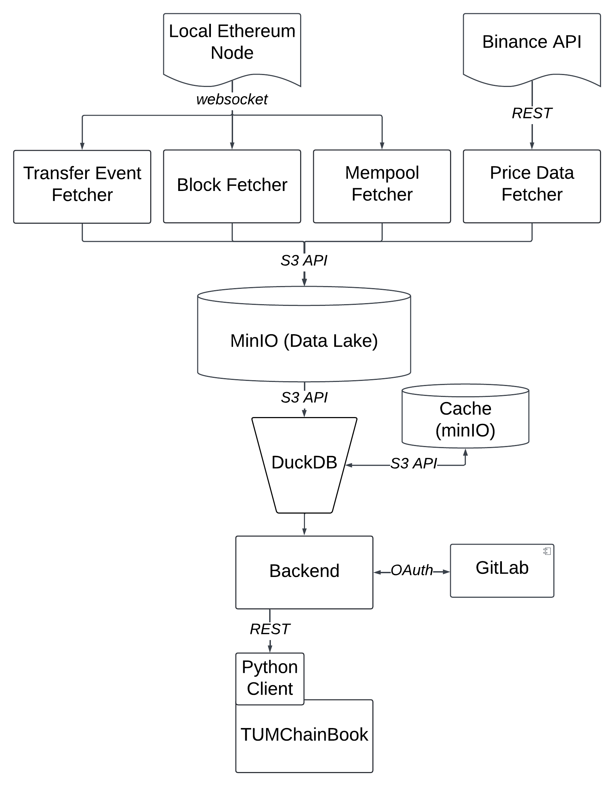

# Building a Production-Ready Data Pipeline for Large-Scale Data Processing

This repository contains the codebase for a production-ready data pipeline developed for ingesting, processing, and serving large-scale blockchain data. It was implemented as part of a Master’s thesis at the Technical University of Munich.

## Overview

The pipeline supports real-time and batch ingestion, efficient querying, and access via JupyterHub. The main use case is Maximal Extractable Value (MEV) analysis, which involves analyzing blockchain transaction patterns, gas prices, and price impacts.

## Architecture



- **Data Sources**: On-chain data from a local Ethereum node (WebSocket) and off-chain price data from Binance API (REST).
- **Ingestion Layer**: Block, transfer event, mempool, and price data fetchers write raw data to MinIO (data lake) via S3 API.
- **Storage**: Data is stored in Parquet format in MinIO.
- **Query Layer**: DuckDB queries data directly from MinIO with a caching layer for faster responses.
- **Access Layer**: A backend with GitLab OAuth serves data through a REST API to a Python client and TUMChainBook (JupyterHub).
- **Monitoring**: Prometheus, Loki, and Grafana provide metrics, logs, and dashboards.

## Use Case: MEV Analysis

The pipeline enables MEV analysis by processing and joining on-chain and off-chain data. It supports research into transaction ordering strategies, arbitrage, and gas fee patterns.

## Performance

The system was tested with 60 concurrent users running Jupyter notebooks. Key results:
- Ingestion latency: ~53 seconds
- Cached query latency: ~16 seconds
- CPU usage remained under 80% during peak load

## Technologies

- MinIO for object storage
- DuckDB for lightweight SQL querying
- JupyterHub for user access
- Kubernetes for orchestration
- Prometheus, Loki, and Grafana for monitoring

## Folder Structure

```
pipeline/
├── kubernetes_deployment/
├── module/
├── services/
├── docker-compose.yaml
```

## Code Structure

- **`kubernetes_deployment/`**: Contains Kubernetes manifests and system setup scripts. These are used to provision a fresh machine, install all necessary dependencies (Docker, Kubernetes, Helm, etc.), and deploy the entire pipeline architecture. It enables full production deployment on a cluster from scratch.

- **`modules/`**: Holds the core business logic. This includes all Python modules responsible for data ingestion, data storage (to MinIO), and data access (querying and serving via DuckDB). Organized by functional domain for clarity and modularity.

- **`services/`**: Each subdirectory here contains the `main.py` entry point and `Dockerfile` for building and running the microservices. These are used to start fetchers, processors, or access services as containers.

- **`docker-compose.yaml`**: Defines the services for local deployment. Allows developers to run the full pipeline stack locally using Docker Compose, ideal for testing and development.


## Deployment

The system runs on Kubernetes. See `kubernetes_deployment/` for manifests and deployment instructions.

## Additional Materials

- [Master's Thesis (PDF)](docs/thesis.pdf)
- [Final Talk Slides (PDF)](docs/final-talk.pdf)

Certainly! Here's the same content formatted in Markdown:

## Adding New Fetchers and Data Sources

To add a new fetcher (and data source), you will need to make changes in three main parts of the codebase:

- `/modules`: for implementing the business logic of your fetcher
- `/services`: for initializing and running the fetcher as a standalone service
- `/kubernetes_deployment`: for deploying your fetcher in a production Kubernetes environment

You can always refer to the existing fetchers as examples when implementing your own. Each part is modular and decoupled, making it easy to plug in new components without affecting the rest of the system.


### Step 1: Add the Fetcher Logic

To add your logic for a new fetcher, you only need to modify the `/modules/data_ingestion` directory thanks to the decoupled structure of the codebase.


Create a new fetcher in:
```
/modules/data_ingestion/<your_fetcher_name>/fetcher.py
```

- This file should extend the `BaseFetcher` class and implement its abstract methods.
- `BaseFetcher` includes utilities for saving data to MinIO and logging progress.
- You can refer to existing fetchers to see how they interact with the Erigon node and perform batch writes.
- If needed, reuse or extend `/modules/data_ingestion/extractors.py` and `/modules/data_ingestion/parsers.py` for common logic shared across fetchers.

### Step 2: Setup the Fetcher Service

Create a new directory for your service at:
```
/services/fetchers/<your_fetcher_name>/
```
Then add:
- `main.py` to initialize and run the fetcher
- `Dockerfile` to define the container image
- `.env.example` and `.env` for your environment variables

Next, register your service in `docker-compose.yaml` so it can be run locally for testing.

### Step 3: Kubernetes Deployment

To deploy your fetcher to the production system:
1. Add a deployment manifest:
```
/kubernetes_deployment/fetchers/<your_fetcher_name>/deployment.yaml
```
Use existing fetchers' manifests as templates.

2. Update:
```
/kubernetes_deployment/install.bootstrap.sh
```
Add a command that builds and applies your new deployment to document and automate the setup.

---

By following these steps, you can integrate a new fetcher cleanly into the existing pipeline with minimal friction.
